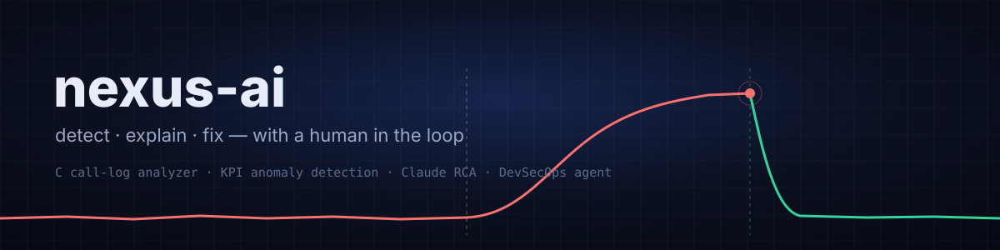
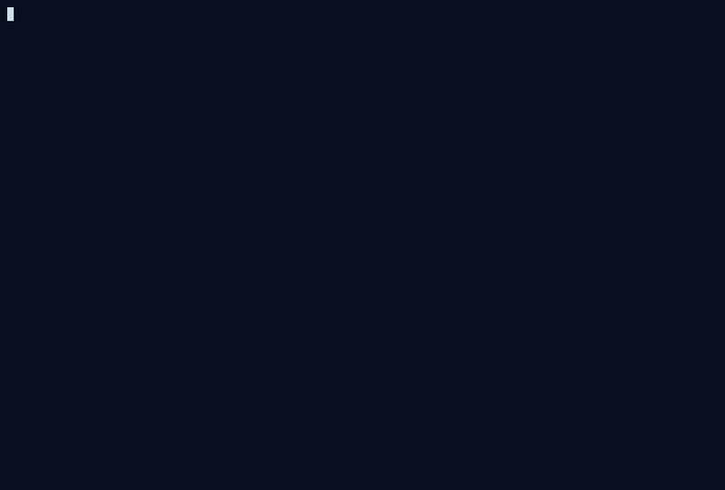
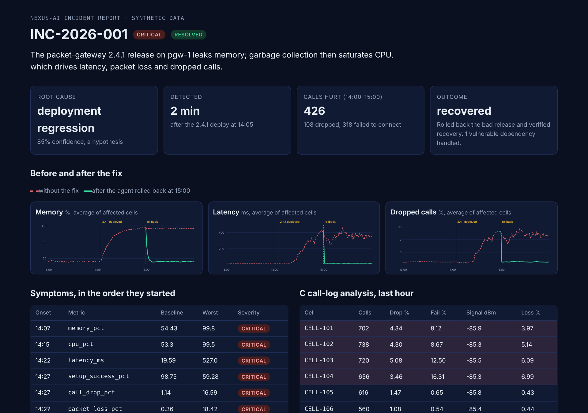
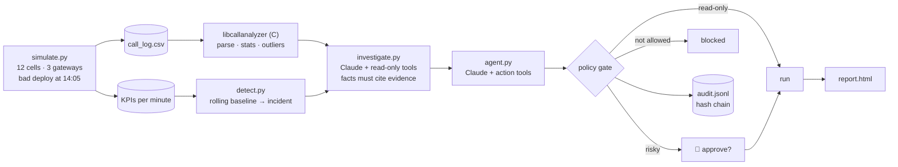

<div align="center">



**A telecom incident, start to finish: a C library reads the call logs, anomaly detection spots the outage, Claude finds the root cause with cited evidence, and a DevSecOps agent fixes it, but only after a human says yes.**


</div>

---

<div align="center">

<br>
<sub>Real run of <code>make demo</code> in offline mode, approving both risky steps. Output is paced for reading; the actual run takes a few seconds.</sub>
</div>

<div align="center">

<br>
<sub>Real run of <code>make demo</code>: the HTML report it writes to <code>out/report.html</code>. Red dashed lines are the network without the fix; green is after the agent's rollback.</sub>
</div>

---

## ✨ What it does

One command plays out a whole outage on a simulated mobile network: 12 cells on 3 packet gateways. At 14:05 a bad release (packet-gateway 2.4.1) goes out to gateway `pgw-1` and starts leaking memory. Then:

| | |
|---|---|
| 📞 **Call-log analysis in C** | `libcallanalyzer` parses and validates the last hour of call records, computes per-cell drop and setup-failure rates, and flags outlier cells with robust z-scores (median and MAD). Python calls it through `ctypes`. |
| 📈 **KPI anomaly detection** | Seven KPIs per cell per minute are checked against a rolling baseline. Anomalies on the same gateway are grouped into one incident, symptoms are put in the order they started, and deployments are ranked as suspects. |
| 🔎 **AI root-cause analysis** | Claude investigates with read-only tools (metrics, deployments, logs, security events, the C analysis). Each tool result gets an evidence id like `E3`, and **every fact in the answer must cite one.** An answer citing evidence that doesn't exist is rejected and sent back. |
| 🛠️ **DevSecOps agent** | A second Claude loop acts on the RCA: rolls back the release, checks the network actually recovered, scans dependencies for CVEs, upgrades the vulnerable one, and runs the tests. |
| 🧑‍⚖️ **Human approval gate** | Every agent action goes through a policy gate. Read-only tools run freely; a rollback or an upgrade **stops and asks you**; anything not on the allowlist is blocked. The agent cannot mark the incident resolved until recovery is verified. |
| 🔗 **Tamper-evident audit log** | Every proposal, approval, denial and result is written to `out/audit.jsonl`, each entry hashing the one before it. Edit one line and verification points at it. |
| 📊 **One-file HTML report** | Summary, before/after charts, the C analysis, the cited facts, every agent action and the code diff. No external files, so it opens anywhere. |

These are the three original goals of the project:

1. **C library for call-log analysis, with AI-driven root-cause investigation** → `c-library/` + `nexus/investigate.py`
2. **AI report of analytics and anomalies from network counters** → `nexus/detect.py` + `nexus/report.py`
3. **Autonomous DevSecOps agent** → `nexus/agent.py`

---

## 🚀 Run it

You need `gcc`, `make` and Python 3.10+. Nothing else is required.

```bash
git clone https://github.com/aryankhanna1409/nexus-ai.git
cd nexus-ai
make demo          # builds the C library, runs everything, writes out/report.html
```

To use Claude for the investigation and the agent instead of the offline fallbacks:

```bash
pip install -r requirements.txt
export ANTHROPIC_API_KEY=sk-ant-...
make demo
```

| Command | What it does |
|---|---|
| `make demo` | The full story. Pauses for a `y/N` before every risky step. |
| `python3 -m nexus demo --yes` | Approve risky steps automatically. |
| `python3 -m nexus demo --offline` | Never call Claude; use the rule-based investigator and the scripted playbook. |
| `python3 -m nexus calls FILE.csv` | Run the C analyzer on any call log and print JSON. |
| `make bench` | Time the C library against plain Python on 1M calls. |
| `make test` | C tests (normal and under ASan/UBSan) plus the Python tests. |

Answer **N** at the rollback prompt and watch the agent stop: the incident stays open and the denial is in the audit log.

---

## 🏗️ System overview



---

## 📁 Repository layout

```
c-library/
  include/callanalyzer.h   public API: parse, stats, per-cell stats, anomaly detection
  src/callanalyzer.c       the library
  src/cli.c                callanalyzer [--json] calls.csv
  tests/                   C tests, also run under AddressSanitizer + UBSan
nexus/
  simulate.py              deterministic network simulator (seeded)
  calls.py                 ctypes binding to the C library
  detect.py                KPI anomaly detection and incident correlation
  ai.py                    the Claude tool-use loop (shared by RCA and agent)
  investigate.py           RCA tools, evidence ids, citation checks, offline fallback
  agent.py                 DevSecOps agent: policy gate, approvals, sandboxed actions
  audit.py                 hash-chained audit log
  report.py                self-contained HTML report with SVG charts
  __main__.py              CLI: demo · calls · bench
demo-workspace/            the tiny service the agent patches (copied to a temp dir first)
tests/                     Python tests, including a fake Claude client
```

---

## ⚙️ How it works

<details>
<summary><b>The C library</b></summary>

- Strict, line-by-line CSV parsing. Bad rows (missing fields, non-numeric values, over-long lines, embedded NUL bytes) are counted and skipped, and the first error is reported with its line number.
- A call's outcome comes from its status code: 2xx completed, 9xx dropped, 3xx–8xx failed to set up.
- Outlier cells are found by comparing each cell's drop rate, setup-failure rate, signal and packet loss to the **median** of all cells, scaled by the **MAD**. A median is not dragged around by the bad cells the way a mean is. A minimum absolute difference stops tiny wobbles from being flagged.
- Compiled with `-Wall -Wextra -Wpedantic -Wconversion -Werror`; the tests also run under AddressSanitizer and UBSan.

</details>

<details>
<summary><b>Detection and correlation</b></summary>

- For each cell and KPI, every minute is compared to the previous hour of normal points. A point is flagged when it is both far from the baseline (z ≥ 4) **and** moved by a meaningful amount (e.g. memory +8 points).
- Consecutive flagged minutes become one anomaly. Anomalies on the same gateway become one incident.
- Deployments shortly before the first symptom on the same gateway are suspects; deployments on other gateways are ruled out. The demo plants a decoy hotfix on `pgw-3` at 13:10 to check this.
- On 20 healthy seeds (no bad deploy), no incident is opened.

</details>

<details>
<summary><b>The AI investigation</b></summary>

- Claude gets seven read-only tools and has to finish by calling `submit_rca` with a root cause, a confidence, facts, alternatives and recommended actions.
- Each tool result is stored with an id (`E1`, `E2`, …). `submit_rca` is checked before it is accepted: every fact needs at least one evidence id, every id must be real, and confidence is capped at 0.95. If the check fails, Claude gets the problems back and tries again.
- Tools are strict JSON schemas, so the inputs always match.
- No API key, `--offline`, or any API error → a deterministic investigator calls the same tools and follows the same citation rules, so the demo never breaks.

</details>

<details>
<summary><b>The agent and its guardrails</b></summary>

| Risk | Tools | What happens |
|---|---|---|
| read-only | `get_rca`, `get_incident_status`, `list_deployments`, `verify_recovery`, `scan_dependencies`, `run_tests`, `finish` | runs |
| needs approval | `rollback_deployment`, `upgrade_dependency` | a human must say yes; a "no" is returned to the agent as a refusal |
| anything else | — | blocked and logged |

- `finish(resolved=true)` is refused unless `verify_recovery` saw the KPIs return to baseline.
- `upgrade_dependency` only moves versions up.
- `run_tests` runs `python -m unittest` with an argument list (no shell), a scrubbed environment and a 60-second timeout, inside a temporary copy of `demo-workspace/`.
- A rollback re-runs the simulator with the leak stopped at 15:00, which is where the green lines in the report come from.

</details>

---

## 🧪 Data honesty

Everything here is synthetic, on purpose, so the demo is repeatable and safe to run.

- The network, call records, logs and security events come from a seeded simulator. Nothing describes a real network or real subscribers.
- The rollback changes the simulation, not a real system. The dependency upgrade edits a `requirements.txt` in a temporary folder.
- `netparse`, `fastjsonx` and the `DEMO-CVE-*` advisories are made up.
- Without an API key, the RCA and the agent are rule-based. The report says which one produced the result.
- `make bench` repeats the same hour of calls to reach 1M rows; on a typical laptop the C library is a few times faster than a plain Python loop while doing much more work.

---

<div align="center">
<sub>MIT licensed · built by <a href="https://github.com/aryankhanna1409">Aryan Khanna</a></sub>
</div>
